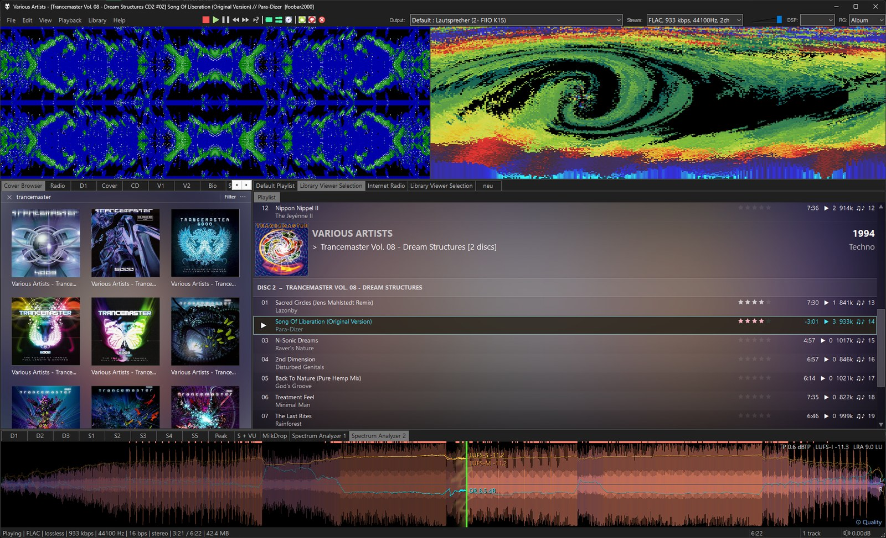
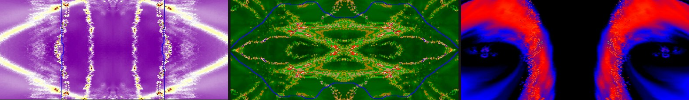
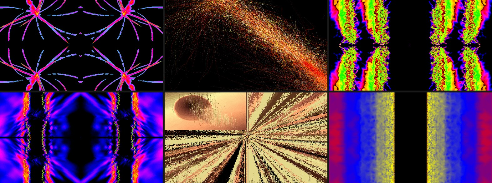
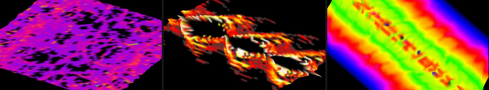
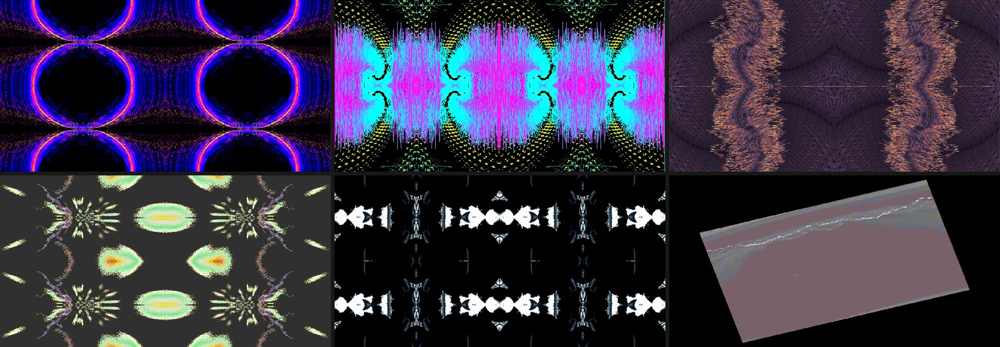
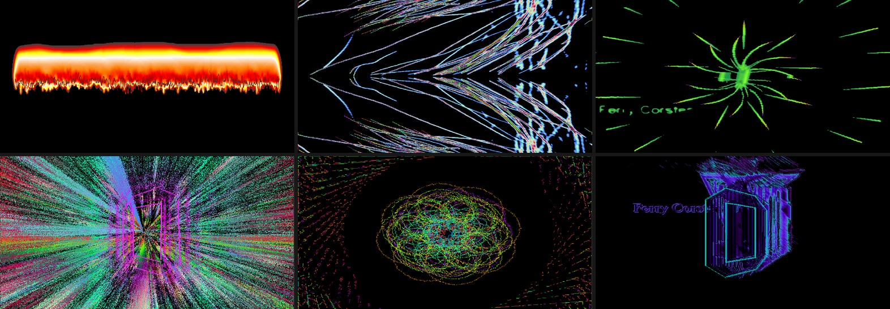
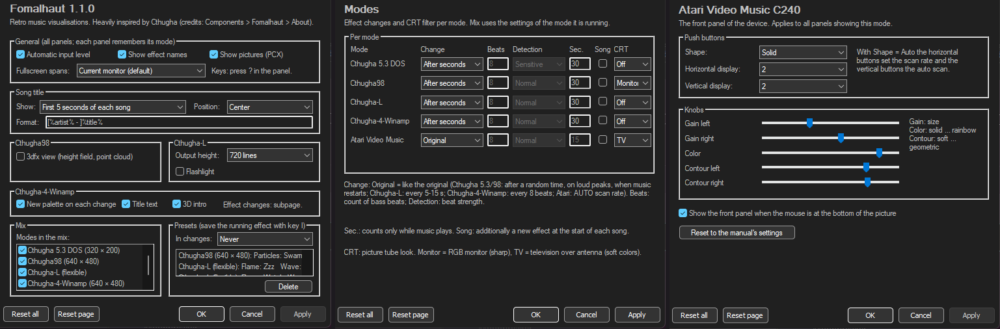

# Fomalhaut

Retro music visualisations inspired by [Cthugha](https://en.wikipedia.org/wiki/Cthugha_(software)) for
[foobar2000](https://www.foobar2000.org)

The sound is drawn into an image that burns, flows and mirrors itself from frame to frame: Cthugha's
"audio seeded image processing", was rebuilt effect for effect from the original programs.

Default UI and Columns UI · 64 and 32 bit · fullscreen on one or more monitors · free

**[Download the latest version](../../releases/latest)** · [foobar2000 component page](https://www.foobar2000.org/components/view/foo_fomalhaut)

\
*Two Fomalhaut panels on top of the layout.*

## Modes

| Mode | Based on |
|---|---|
| Cthugha 5.3 DOS (320 × 200) | Cthugha 5.3 for DOS (1995), with all extras: palettes, pictures and translation tables |
| Cthugha98 (640 × 480) | Cthugha98 0.6a for Windows (1998), including its particle scenes and all 3D views of the 3dfx version |
| Cthugha-L (flexible) | Cthugha-L 1.4 for Linux (2000), adapts to the panel size, has new 3D displays |
| Cthugha-4-Winamp (640 × 480) | The Cthugha plug-in for Winamp (and ModPlug) (1998): beat-driven, 3D title intro, song title text |
| Mix | All of the above in turn, with a short fade between them |

Each panel remembers its own mode, so several panels can run different modes side by side.

### Cthugha 5.3 DOS

\
*The DOS version at its original 320 × 200: mirrored and kaleidoscope displays with the Cthugha 5.3 palettes and
pictures.*

### Cthugha98

\
*Cthugha98 at 640 × 480: flames and waves, the particle scenes (top middle) and translation tables.*

\
*The optional 3dfx view of Cthugha98: the image as a turning height field, rebuilt in software.*

### Cthugha-L

\
*Cthugha-L fills any panel size: its mirrored displays, palettes from the Linux version and the 3D displays (bottom
right).*

### Cthugha-4-Winamp

\
*The Winamp plug-in: flames and waves change with the beat; at the start of each song turning 3D letters spell the
title (right).*

## Requirements

- foobar2000 2.0 or newer, 64-bit or 32-bit
- Windows 10 or 11

## Installation

1. Download `foo_fomalhaut-<version>.fb2k-component` from the [releases](../../releases/latest).
2. Double-click it, or use *Preferences → Components → Install…*, and restart foobar2000.
3. Add the panel:
   - **Default UI:** *View → Layout → Enable layout editing*, right-click an area, *Add New UI Element →
     Visualisation → Fomalhaut*.
   - **Columns UI:** *Preferences → Columns UI → Layout*, add *Fomalhaut* (category *Visualisations*).
4. Right-click the panel and choose a mode under *Mode*. Play music and enjoy.

## Usage

| Action | Effect |
|---|---|
| Click, Space | Next effect |
| Middle click, F11 | Fullscreen on/off (Esc leaves) |
| Right click | Menu: next / previous effect, lock, fullscreen, presets, mode, options |
| f / w / d / p | Next flame / wave / display / palette |
| t, ! | Colour table (Cthugha-4-Winamp: translation), translation table |
| s | FFT palette flashing (DOS) / scope or analyzer (Cthugha-4-Winamp) |
| h | Wave scale (Cthugha-4-Winamp) |
| L | Lock: no automatic effect changes |
| i | Save the running effect as a preset |
| ? or F1 | Show the keys |

Like Cthugha's `CTHUGHA.INI`, saved presets come up in the automatic changes — in 2 of 3 changes by default, or
never or always.

## Preferences

\
*The main page and the "Effect changes" subpage.*

*Preferences → Visualisations → Fomalhaut*:

- Automatic input level (on by default): the originals listened to a sound card set to a lively level; today's
  quieter music is raised to a similar level, silence stays silence. If the picture gets too 'loud' switch it off.
- Effect names, pictures, song title (first seconds of each song or always; title format and position).
- Per mode: the 3dfx view of Cthugha98, output height and flashlight of Cthugha-L, palettes, title text and 3D intro
  of Cthugha-4-Winamp, the modes in the mix, presets.

*Preferences → Visualisations → Fomalhaut → Effect changes*, for each mode:

- **Original** (default): exactly as the original program changed effects.
- **After beats**: after a number of bass beats, with adjustable beat detection. Note: does not work well for all styles.
- **After seconds**: every few seconds while music plays.
- **New song**: additionally a new effect at the start of each song.

## True to the originals

- Rebuilt from the originals themselves: the published C source of Cthugha 5.3 and Cthugha-L, and the program code
  of Cthugha98 and of the Winamp plug-in. Formula for formula, with the same tables, colours and random sequence of
  each original.
- Original picture sizes and frame rates: 320 × 200 at 70 Hz for DOS, 640 × 480 for Cthugha98 and the Winamp
  plug-in, 25 frames per second for Cthugha-L.
- Sound as the originals heard it: 8-bit samples from the same number of frames; the Winamp mode gets Winamp's
  576-value waveform and spectrum.
- The original effect changes: random scene lengths, loud peaks, music returning after a pause, beats.
- All extras: 32 palettes and 12 pictures of Cthugha 5.3, 169 palettes and the pictures of Cthugha-L, 73 palettes,
  the 3D letters and the title picture of the Winamp plug-in, translation tables of all versions.
- The texts shown during silence, in the original 8 × 14 VGA font.
- Quirks that are part of an effect stay as they were.

## Fixed bugs of the originals

Where an original had a bug that spoiled an effect, Fomalhaut shows what the effect was (most probably) meant to look like:

- **Cthugha 5.3 DOS:** "Downwards" did not mirror; both kaleidoscopes left a stripe; the rotated displays showed
  parts of the image without any waves; the built-in palettes were only partly converted to VGA colours; large
  pictures were cut off at the top left; with one picture palette the waves were invisible.
- **Cthugha98:** the kaleidoscope did not mirror; the 90° displays never showed the waves or filled only part of the
  screen; Rings of Fire drew nothing at small sizes; translations and pictures were distorted on the split
  displays.
- **Cthugha-L:** tall pictures were shifted, Zick Zack cleared too much, tables without a header were ignored, and
  for a moment two translations could mix.
- **Cthugha-4-Winamp:** two waves read beyond the sound data; Fire works and School of fish could crash; the 3D
  intro ran endlessly when nothing played.
- **All modes:** a preset no longer comes twice in a row; reads and writes outside the image are prevented
  everywhere.

## Credits

- Cthugha © 1993–1998 Kevin "Zaph" Burfitt, Torps Productions
- Cthugha-L © 1995–1998 Harald Deischinger
- Cthugha-4-Winamp © 1998 Krunoslav Pisacic (beat detection by Justin Frankel, Nullsoft)
- Extras of Cthugha 5.3: palettes and pictures by Torps Productions; "Images and Colors" vol. 1 © 1989,
  1993–1994 Dmitry Altukhov (Dreamwalker / ORBiS TERTiUS); "chromatic" palette by Todd Hedenstrom; translation table
  generators by Ofer Faigon

Fomalhaut is based on the ideas and algorithms of Cthugha, used under the Cthugha source license (free for
non-commercial use, with credit). It is free and not affiliated with the authors of Cthugha or of the Winamp
plug-in. BTW: Fomalhaut is the home star of Cthugha in H. P. Lovecraft's mythology.

## License

Copyright (c) 2026 Audio Lens. All rights reserved. The component is free of charge and may not be used
commercially; the unmodified package may be passed on. See [LICENSE.txt](LICENSE.txt). This repository contains
documentation and releases only; the source code is not published.

The licenses of Cthugha, Cthugha-L and Cthugha-4-Winamp and of the foobar2000 SDK, pfc, libPPUI, the Columns UI SDK
and WTL are in [THIRD-PARTY-NOTICES.txt](THIRD-PARTY-NOTICES.txt).

...there is more to come.