# Fomalhaut

Retro music visualisations inspired by [Cthugha](https://en.wikipedia.org/wiki/Cthugha_(software)), the
[Atari Video Music](https://en.wikipedia.org/wiki/Atari_Video_Music), the music trackers of the Amiga, DOS, C64
and CPC and the [Compact Cassette](https://en.wikipedia.org/wiki/Cassette_tape) for
[foobar2000](https://www.foobar2000.org), [Winamp](https://www.winamp.com) / [WACUP](https://getwacup.com) and
[AIMP](https://www.aimp.ru)

Sound is drawn into an image that burns, flows and mirrors itself from frame to frame: Cthugha's
"audio seeded image processing", rebuilt effect for effect from the original programs. The very first home music
visualiser, Atari's Video Music C240 from 1977, returns as a true-to-life circuit simulation. The
screens of 18 classic trackers come alive and play along with your music. And your playlist turns into a cassette
that runs in a working tape deck of the 70s, 80s or 90s.

Default UI and Columns UI · 64 and 32 bit · fullscreen across one or more monitors · free · also available as a
plug-in for Winamp / WACUP and AIMP

**[Download the latest version](../../releases/latest)** · [foobar2000 component page](https://www.foobar2000.org/components/view/foo_fomalhaut) · Videos: [1.3 – Cassette mode and AIMP](https://youtu.be/P4ajUVvxVA4) · [1.2 – presentation](https://youtu.be/Ecsgio12U5g)

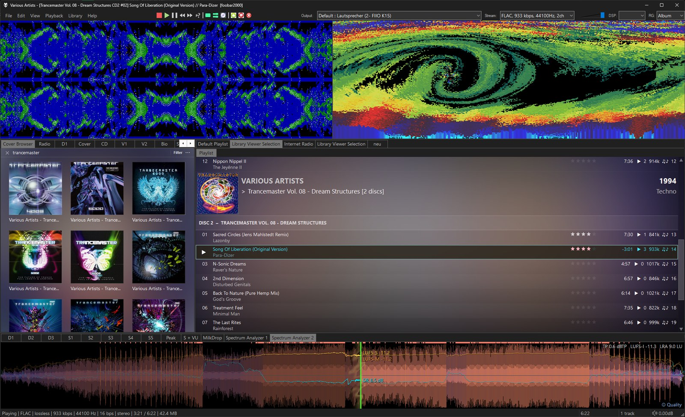\
*Two Fomalhaut panels on top of the layout.*

## Modes

| Mode | Based on |
|---|---|
| Cthugha 5.3 DOS (320 × 200) | Cthugha 5.3 for DOS (1995), complete with all extras: palettes, pictures and translation tables |
| Cthugha98 (640 × 480) | Cthugha98 0.6a for Windows (1998), including its particle scenes and all 3D views from the 3dfx version |
| Cthugha-L (flexible) | Cthugha-L 1.4 for Linux (2000), adapts to any panel size and adds new 3D displays |
| Cthugha-4-Winamp (640 × 480) | The Cthugha plug-in for Winamp (and ModPlug) (1998): beat-driven, with 3D title intro and song title text |
| Atari Video Music C240 (4:3) | The Atari Video Music C240 (1977): diamonds, holes and rings in the colours of the music, complete with its front panel |
| Tracker (Amiga, DOS, Windows, C64, CPC) | 18 music trackers from Ultimate Soundtracker (1987) to Arkos Tracker 3, with screens playing along to your music |
| VSG+ DOS (640 × 480) | VSG 1.0 VGA for DOS by Neven Pintaric (2000): 20 effects in QuickBASIC style and 16 colour palettes |
| Compact Cassette (flexible) | The Compact Cassette (Philips, 1963): your playlist as a running cassette, blank or printed from the album cover, in seven working tape decks of the 70s, 80s and 90s |
| Credits | The credits for all modes roll by, each section running its own mode in the background |
| Mix | Cycles through all of the above (except Credits) with a short crossfade between them |

Each panel remembers its own mode, so you can run several panels with different modes side by side. Every mode can also be viewed
through an optional CRT filter (RGB monitor or TV).

### Cthugha 5.3 DOS

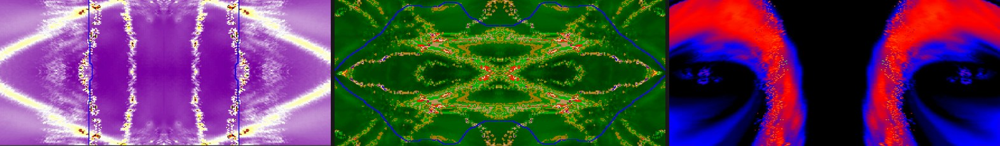\
*The DOS version at its original 320 × 200: mirrored and kaleidoscope displays with the Cthugha 5.3 palettes and
pictures.*

### Cthugha98

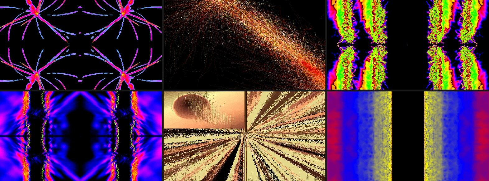\
*Cthugha98 at 640 × 480: flames and waves, the particle scenes (top middle) and translation tables.*

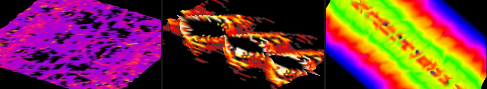\
*The optional 3dfx view of Cthugha98: the image rendered as a rotating height field, rebuilt in software.*

### Cthugha-L

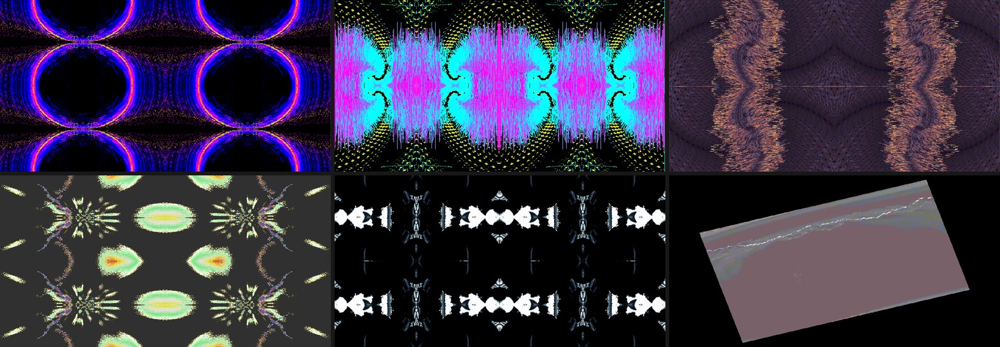\
*Cthugha-L fills any panel size: its mirrored displays, palettes from the Linux version and the 3D displays (bottom
right).*

### Cthugha-4-Winamp

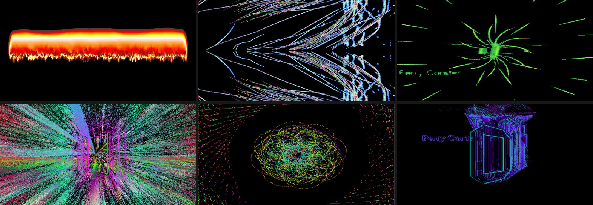\
*The Winamp plug-in: flames and waves react to the beat; at the start of each song, rotating 3D letters spell out the
title (right).*

### Atari Video Music C240

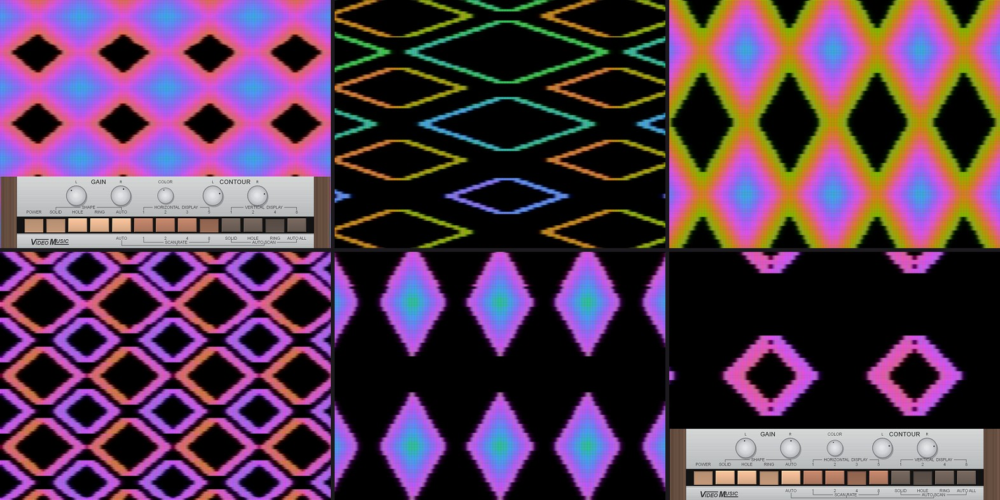\
*Hole, Ring and Solid in different grids, just like on a TV set; the front panel slides in at the bottom (top left, bottom
right).*

Not just a visual imitation, but a circuit-level simulation of the actual device: the analogue input stage uses the exact component values
from the schematic, and the custom chip logic follows the original patent. Left and right channels each draw a diamond whose
size follows the loudness and whose colour follows the pitch.

- Hover the mouse at the bottom of the picture to slide in the **front panel**. Press the buttons and turn the knobs
  (by dragging or using the mouse wheel) just like on the real hardware: Solid, Hole, Ring or Auto; 1 to 5 shapes across and 1 to 8 down; Auto
  scan rate; gain, colour and contour per channel.
- **POWER** switches the set off like a classic CRT: the picture collapses into a bright line, then shrinks to a dot that
  fades out. It wakes back up with the next song, after 20 seconds, or when you click the picture. Stop and pause
  switch it off as well, while play brings it back on.
- All controls are also accessible via the right-click menu and the preferences. *Reset to the manual's settings* restores the
  controls to the setup recommended in the original owner's manual.
- Uses the *TV* CRT filter by default for an authentic television look.

Thanks to Robert J. Brown for being a true pioneer in music visualisation and bringing this into living rooms back in 1977!

### Tracker

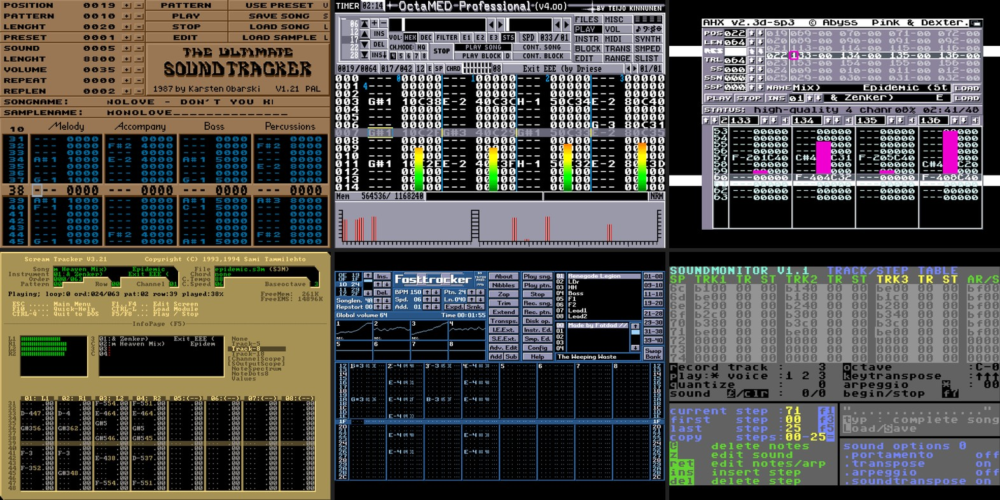\
*Ultimate Soundtracker, OctaMED and AHX on the Amiga (top), Scream Tracker 3 and Fasttracker II for DOS and
SoundMonitor on the C64 (bottom).*

The screens of 18 classic music trackers, faithfully recreated from emulator recordings of the real programs, play along with
whatever you are listening to: notes scroll through the pattern in time with the music, VU meters, scopes and
analyzers react to the audio, the track title appears in the song name field, and position and length follow the song's progress.

- **Amiga:** Ultimate Soundtracker 1.21, D.O.C SoundTracker 2.0, SidMon 2.1, NoiseTracker 2.0, Future Composer 1.4,
  ProTracker 2.1A, OctaMED Professional 4.0, Oktalyzer 1.57, AHX 2.3d
- **DOS:** Composer 669 1.3, Scream Tracker 3.21, Fasttracker II, Impulse Tracker 2.14
- **Windows:** ModPlug Tracker 1.16
- **C64:** SoundMonitor 1.1, JCH Editor 3.04
- **Amstrad CPC:** Soundtracker DMA 2.0, Arkos Tracker 3
- Press P to cycle through colour schemes, starting with the original and followed by palettes from the program and its siblings. Press D
  to switch between different tracker views (pattern editor, instruments, scopes …).
- *Preferences → Mode options*: scroll rows at the estimated tempo of the music or at a fixed 125 BPM; cycle through trackers in order or
  at random.

### VSG+ DOS (640 × 480)

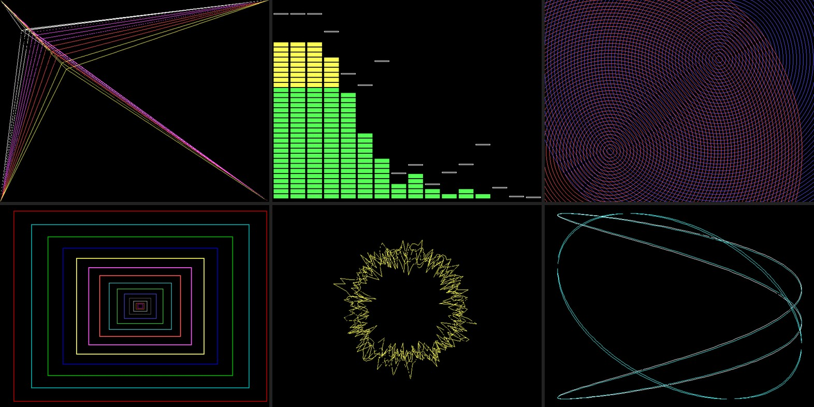\
*Strings, VU bars and moiré (top), tunnel, circle scope and Lissajous (bottom).*

VSG ("View sounds in graphics") was a neat little DOS program written in QuickBASIC by Neven Pintaric in 2000. It read
the sound card directly and drew circles, lines and dots on a 640 × 480 VGA screen in 16 colours. Fomalhaut preserves that
exact look and expands it into VSG+ with 20 effects:

- Rebuilt from the original code, now in colour: two circles, bars, two traces, scope, rolling circles and crosshair.
- Brand-new effects in the same spirit: phase loops, worms, strings, sine waves, VU bars, band circles, starfield, tunnel, radar,
  circle scope, bouncing balls, moiré, Lissajous and fireworks.
- Press P to switch palettes: EGA, black & white, retro palettes from the Amstrad CPC, C64, Amiga, Sega Master System
  and NES, and more.
- Automatically switches effects on a beat after about 20 seconds (whereas the original required the arrow keys).

### Compact Cassette

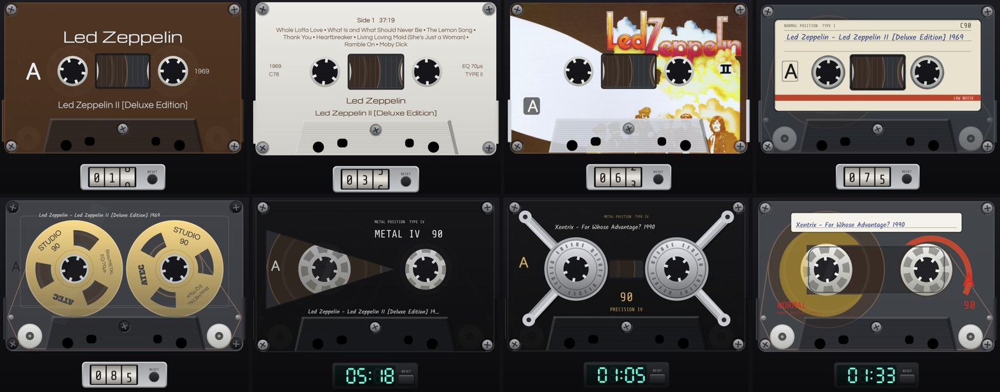\
*Bought cassettes printed from the album cover – Album Print, Album Tracklist, Album Art (top left) – and blank
cassettes from the 70s to the 90s, optional with mechanical and digital counters.*

The idea is, that your playlist becomes a cassette: the tracks of an album (or of the playlist) are laid out on sides A and B of a
C46 … C120, the reels turn with real tape physics, the windings grow and shrink, the counter runs, and at the end
of side A the cassette is turned over.

- **Blank cassettes:** 21 types from the 70s to the 90s in ten colours each, with handwritten label, tape type I–IV
  and the occasional wobbly winding. Press Space for the next type and P for the colours.
- **Bought cassettes from the album cover:** Album Print, Album Tracklist, Album Tint and Album Art are printed in
  the colours or with the picture of the cover, with artist, album, year and the titles of the side.
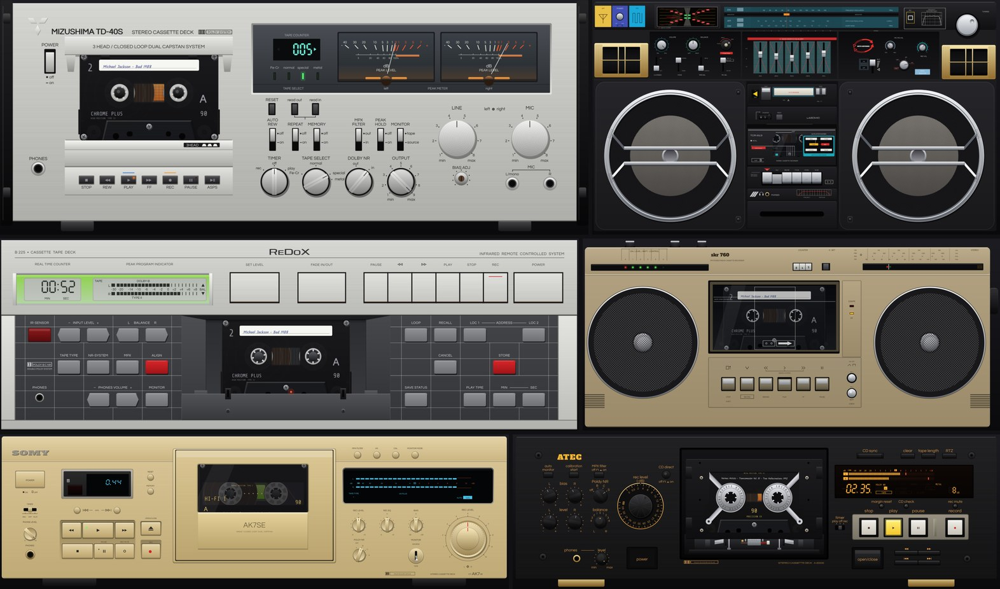\
*All currently included tape decks from the 70s to the 90s. Some are available in several colors / finishes.*

- **Tape decks:** a 70s three-head deck, an 80s studio deck with real-time counter, locator and loop, an 80s
  ghetto blaster, an 80s East German radio recorder, a 90s closed-loop deck and a 90s three-head deck. Their
  buttons, switches and knobs work: play, pause, stop, rewind and fast forward control the player, the volume and
  balance knobs follow it, counters can be reset and memories set. Press W for the next deck, F for its finish and
  F2 for a short description of what it can do.
- *Preferences → Mode options → Tape*: cassette, colours, deck, how the sides are filled and the colour of digital
  counters.

### Credits

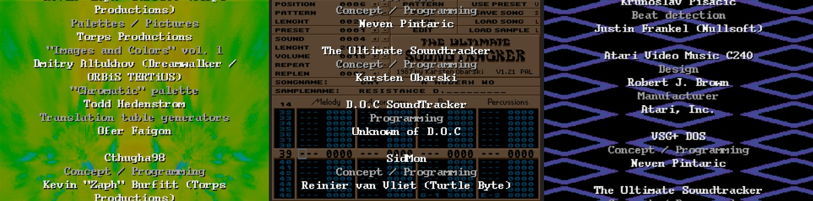\
*The credits over Cthugha 5.3 DOS, Ultimate Soundtracker and the Atari Video Music.*

The credits for everyone behind the original programs roll by in classic VGA font. As each section reaches the centre of the
screen, the background smoothly crossfades to that exact mode or tracker.

## Requirements

- foobar2000 2.0 or newer, 64-bit or 32-bit
- or Winamp 5.x / WACUP, 32-bit (64-bit WACUP does not support third-party plug-ins yet)
- or AIMP 5.x, 64-bit or 32-bit (also runs with the AIMP 6 beta)
- Windows 10 or 11

## Installation

1. Download `foo_fomalhaut-<version>.fb2k-component` from the [releases](../../releases/latest).
2. Double-click the file, or go to *Preferences → Components → Install…*, and restart foobar2000.
3. Add the panel to your layout:
   - **Default UI:** *View → Layout → Enable layout editing*, right-click an area, and select *Add New UI Element →
     Visualisation → Fomalhaut*.
   - **Columns UI:** *Preferences → Columns UI → Layout*, and add *Fomalhaut* (under *Visualisations*).
4. Right-click the panel, pick a mode under *Mode*, put on some music and enjoy.

## Winamp and WACUP

All modes are also available as a visualisation plug-in for Winamp and WACUP (32-bit).

1. Download `vis_fomalhaut-<version>.zip` from the [releases](../../releases/latest).
2. Close Winamp / WACUP and drop `vis_fomalhaut.dll` into its *Plugins* folder.
3. Open *Preferences → Plug-ins → Visualisation*: select *Fomalhaut*, pick your desired mode under *Plug-in module* and hit
   *Start* (or press Ctrl+Shift+K).

- **Portable WACUP:** make sure third-party plug-ins are enabled first under *Preferences → Advanced → Portable Mode*.
- To launch the visualisation automatically with the player, tick *Run the plug-in(s) on start-up* in the
  Visualisation preferences.
- The window docks right into the skin just like MilkDrop. Keyboard shortcuts and the right-click menu work the same way as in foobar2000; any keys Fomalhaut
  does not use (Z, X, C, V, B, arrows …) are passed straight through to the player. Your last selected mode is remembered automatically.
- Settings: click *Configure* in the Winamp preferences or *Preferences…* in the right-click menu to get the exact same settings pages as in
  foobar2000, neatly arranged in tabs.
- Because Winamp only feeds short audio chunks to visualisations (576 samples, roughly 60 times a second),
  Fomalhaut stitches them into a continuous stream and bridges small gaps. As a result, Atari Video Music and Cthugha98
  occasionally see repeated audio data in Winamp, whereas in foobar2000 every mode receives the complete, uninterrupted audio stream.

## AIMP

All modes are also available as a visualisation plug-in for AIMP 5 (64-bit and 32-bit); it already runs with the
AIMP 6 beta as well.

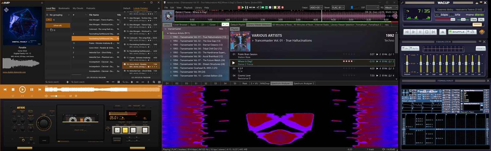\
*Fomalhaut in AIMP (90s three-head deck), foobar2000 (a Cthugha mode) and WACUP (Fasttracker II) side by side.*

1. Download `aimp_fomalhaut-<version>.aimppack` from the [releases](../../releases/latest).
2. Double-click the file, or in AIMP open *Preferences → Plugins*, click *Install* and choose it. AIMP picks the
   right version (64 or 32 bit). Tick *Fomalhaut* in the list, click *OK* and restart AIMP.
   (The `.aimppack` is a ZIP archive in AIMP's add-on format; for a manual install see `README.txt` inside.)
3. Right-click the visualisation area and pick one of the *Fomalhaut: …* entries (one per mode).

- **Mouse:** left click = next effect (on the tape decks: buttons, switches and knobs, also by dragging and with the
  mouse wheel), middle click = Fomalhaut menu, right click = AIMP's own menu. The control bar slides in at the top.
- **Keys:** AIMP keeps all keys for itself. Assign Fomalhaut's commands (next effect, F, W, D, P …, lock,
  screenshot …) to keys of your choice under *Preferences → Hotkeys*, group *Fomalhaut*.
- **Settings:** *Preferences → Plugins → Fomalhaut* (five pages, light or dark like the skin), also via
  *Fomalhaut settings…* in AIMP's main menu or *Preferences…* in the Fomalhaut menu.
- AIMP draws visualisations about 32 times a second and passes only short audio chunks (512 samples per frame).
  Fomalhaut keeps every mode running in real time and fills the gaps in the audio, so Atari Video Music and
  Cthugha98 see more repeated audio than in Winamp. For the full frame rate, use Fomalhaut's own fullscreen window
  (*Fullscreen* in the Fomalhaut menu).

## Usage

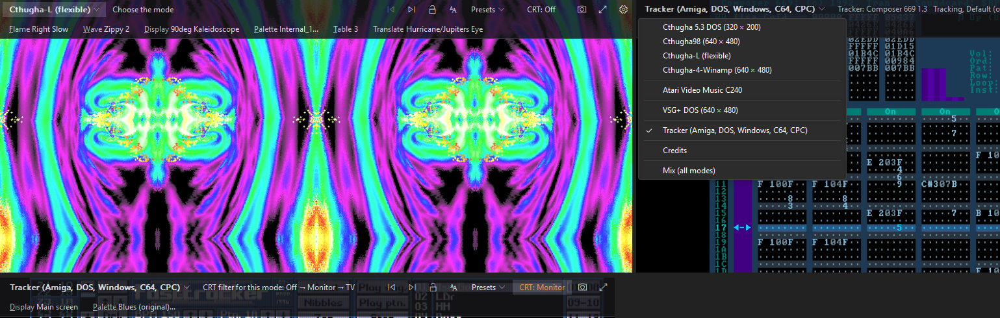\
*The control bar with the second row of the Cthugha modes (left), the mode menu (right) and a tooltip when hovering
over a button (bottom).*

| Action | Effect |
|---|---|
| Click, Space | Next effect (clicking an inactive panel simply gives it keyboard focus first; click switching can be toggled via "Click changes effect") |
| Backspace | Previous effect |
| Middle click, F11 | Toggle fullscreen (Esc to exit) |
| Hover at the top | Slides in the control bar: mode, previous / next, lock, effect names, palette, presets, CRT filter, screenshot, fullscreen, preferences; Cthugha modes also get a second row for flame, wave, display, palette … (matching the hotkeys) plus Cthugha98's 3dfx view |
| Right click | Opens the context menu: next / previous effect, lock, fullscreen, screenshot, mode, palette (pick from list), presets, CRT filter, options |
| f / w / d / p | Next flame / wave / display / palette (also resets the timer for the next automatic change) |
| Shift + letter | The same key backwards, in all modes (e.g. Shift+P: previous palette) |
| t, ! | Colour table (Cthugha-4-Winamp: translation), translation table |
| s | FFT palette flashing (DOS) / scope or analyzer (Cthugha-4-Winamp) |
| h | Wave scale (Cthugha-4-Winamp) |
| L | Lock: pauses automatic effect changes |
| i | Save the current effect as a preset |
| n | Toggle effect names on/off |
| ? or F1 | Show the keys of the running mode |
| F2 | Tape: what the deck can do, in a few lines |

**Screenshot** (via the right-click menu or control bar): grabs a clean PNG at the exact panel resolution, free of
menus, bars or effect names. Screenshots are saved with sequential numbers to your last-used folder (*Fomalhaut 001.png*,
*Fomalhaut 002.png* …); *Save screenshot as…* lets you pick a folder and file name (and always pops up on your very first screenshot, starting
in the program folder).

**Presets:** press i to save the currently running effect; the *Presets* submenu in the right-click menu lists all saved presets for the active mode. Just like
Cthugha's original `CTHUGHA.INI`, the Cthugha modes weave your presets into automatic transitions — showing up in 2 out of 3 changes by
default, never, always, or at a custom percentage of your choice, either randomly or in list order.

## Preferences

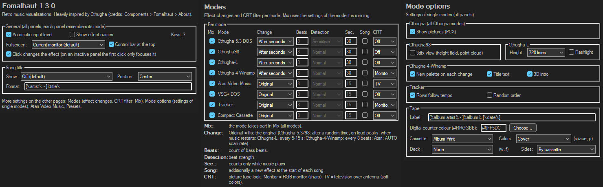\
*The main page, "Modes" and "Mode options" (subpages "Atari Video Music" and "Presets" not shown).*

*Preferences → Visualisations → Fomalhaut*:

- Automatic input level (enabled by default): the original programs expected a lively sound card signal; this gently boosts quieter modern
  tracks to a similar level while keeping silence silent. If the visuals ever feel a bit too intense, simply switch it off.
- Effect names, pictures, click-to-change-effect, fullscreen monitor selection, and song title display (shown during the first few seconds of a track or
  permanently, with customisable formatting and placement).
- Top control bar (enabled by default): slides into view whenever the mouse moves into the upper quarter of the panel.

*Preferences → Visualisations → Fomalhaut → Mode options*: configure Cthugha98's 3dfx view, Cthugha-L's output height and
flashlight, Cthugha-4-Winamp's palettes, title text and 3D intro, tracker tempo and playback order, and for the Compact
Cassette the label of blank cassettes (title formatting), the colour of digital counters, the cassette, colours and deck
new panels start with, and how the tracks are spread over the two sides.

*Preferences → Visualisations → Fomalhaut → Modes*, individually configurable per mode (including whether it appears in the Mix):

- **Original** (default): switches effects just like the original program did.
- **After beats**: switches after a set number of bass beats, with adjustable beat sensitivity. Note: may not suit every genre equally well.
- **After seconds**: switches at a fixed time interval while music is playing.
- **New song**: also triggers a fresh effect whenever a new track starts.
- **CRT**: off, RGB monitor (crisp) or TV (softer colours). Defaults to TV for Atari Video Music and off for all other modes.

*Preferences → Visualisations → Fomalhaut → Atari Video Music*: mirrors the buttons and knobs of the hardware front panel, plus an option
to toggle the slide-in panel. Each panel maintains its own controls; the preferences dialog reflects and adjusts whichever
panel you interacted with last, and newly created panels inherit those settings.

*Preferences → Visualisations → Fomalhaut → Presets*: rename, delete and reorder saved presets (including batch selection), double-click a preset to preview it directly in the panel, configure how often presets appear during automatic changes, and export or import them as a
plain text file (one preset per line: `mode|name|scene`; importing appends to your existing list and automatically skips duplicates). Supports up to 512
presets.

## True to the originals

- Rebuilt straight from the source: based on the published C source code of Cthugha 5.3 and Cthugha-L, alongside the disassembled binaries
  of Cthugha98 and the Winamp plug-in — formula for formula, preserving the exact tables, palettes and random number sequences of
  each original.
- Authentic resolutions and frame rates: 320 × 200 at 70 Hz for DOS, 640 × 480 for Cthugha98 and the Winamp
  plug-in, and 25 fps for Cthugha-L.
- Audio fed the way the originals heard it: 8-bit samples across the exact same frame counts, while the Winamp mode receives Winamp's classic
  576-sample waveform and spectrum data.
- Original transition logic: random scene durations, loud audio peaks, music resuming after a pause, and beat triggers.
- Every classic extra included: 32 palettes and 12 pictures from Cthugha 5.3, 169 palettes and the pictures from Cthugha-L, 73 palettes,
  the 3D font and title image from the Winamp plug-in, plus the translation tables across all releases.
- Classic idle messages during silence, rendered in the original 8 × 14 VGA font.
- Intentional quirks that define the character of an effect are faithfully preserved.
- Atari Video Music: reconstructed from US patent 4,081,829, the circuit schematics and the owner's manual – the image is drawn
  line by line just like the hardware's 262 scanlines at 60 Hz, sampling the audio level live for each line (which gives the shapes their
  characteristic jittery edges). Shape sizes, colours and the internal rainbow effect were calibrated against video captures of real
  hardware. One deliberate tweak: on mono signals, Hole and Ring remain visible (whereas the real unit went completely black
  on loud mono passages).
- Tracker: layouts, bitmap fonts and colour palettes captured straight from WinUAE, DOSBox, VICE and Windows;
  VU meters and scopes respond just like the real trackers (with ProTracker following pt2-clone). Note patterns do not read an actual module file, but are
  generated live from the audio spectrum.

## Fixed bugs of the originals

Where a bug in the original code broke or spoiled an effect, Fomalhaut restores how the effect was (most likely) intended to look:

- **Cthugha 5.3 DOS:** "Downwards" failed to mirror; both kaleidoscopes left a visible seam; rotated displays left
  parts of the screen without waves; built-in palettes were only partially converted to VGA range; large
  pictures were clipped at the top left; one picture palette rendered the waves completely invisible.
- **Cthugha98:** the kaleidoscope did not mirror; 90° displays either lacked waves entirely or only covered part of the
  screen; Rings of Fire drew nothing at smaller sizes; split displays distorted translations and background pictures.
- **Cthugha-L:** tall pictures appeared shifted, Zick Zack cleared too much of the screen, headerless tables were ignored, and
  two translations could briefly bleed into each other.
- **Cthugha-4-Winamp:** two wave types read past the end of the audio buffer; Fire works and School of fish could crash; the 3D
  intro looped forever when playback was stopped.
- **All modes:** presets no longer repeat back-to-back, and out-of-bounds memory reads/writes across image buffers are caught
  everywhere.

## Credits

- Cthugha © 1993–1998 Kevin "Zaph" Burfitt, Torps Productions
- Cthugha-L © 1995–1998 Harald Deischinger
- Cthugha-4-Winamp © 1998 Krunoslav Pisacic (beat detection by Justin Frankel, Nullsoft)
- Extras of Cthugha 5.3: palettes and pictures by Torps Productions; "Images and Colors" vol. 1 © 1989,
  1993–1994 Dmitry Altukhov (Dreamwalker / ORBiS TERTiUS); "chromatic" palette by Todd Hedenstrom; translation table
  generators by Ofer Faigon
- Atari Video Music C240 (1977) by Atari, Inc., designed by Robert J. Brown (US patent 4,081,829)
- VSG 1.0 VGA by Neven Pintaric
- Trackers: Ultimate Soundtracker by Karsten Obarski; D.O.C SoundTracker by Unknown of D.O.C; SidMon by Reinier
  van Vliet; NoiseTracker by Mahoney & Kaktus; Future Composer by SuperSero (The Superions); ProTracker by Noxious
  (reference: pt2-clone by Olav "8bitbubsy" Sørensen); OctaMED by Teijo Kinnunen; Oktalyzer by Armin Sander; AHX by
  Dexter and Pink (Abyss); Composer 669 by Tran (Renaissance); Scream Tracker by Sami Tammilehto (Future Crew);
  Fasttracker II by Fredrik Huss and Magnus Högdahl (reference: ft2-clone by Olav Sørensen); Impulse Tracker by
  Jeffrey Lim; ModPlug Tracker by Olivier Lapicque; SoundMonitor by Chris Hülsbeck; JCH Editor by Jens-Christian
  Huus; Soundtracker DMA by Zik (Futurs'); Arkos Tracker by Julien Nevo

Fomalhaut builds upon the ideas and algorithms of Cthugha under the Cthugha source license (free for
non-commercial use with credit). It is a free project and is not affiliated with the authors of Cthugha or the Winamp
plug-in. Atari and Video Music are trademarks of their respective owners; Fomalhaut's Atari mode is an independent
simulation and is neither affiliated with nor endorsed by them. The tracker screens are tributes to their respective
programs; all names belong to their respective owners, with no affiliation or endorsement implied. BTW: Fomalhaut is the home star of Cthugha in H. P. Lovecraft's mythology.

## License

Copyright (c) 2026 Stefan Eireiner. All rights reserved. Fomalhaut is free of charge; unmodified packages may be
freely shared as long as no fee is charged. See [LICENSE.txt](LICENSE.txt). This repository hosts
documentation and release builds only; the source code is not public.

Licenses for Cthugha, Cthugha-L, Cthugha-4-Winamp, the foobar2000 SDK, pfc, libPPUI, the Columns UI SDK
and WTL can be found in [THIRD-PARTY-NOTICES.txt](THIRD-PARTY-NOTICES.txt).

...there is more to come.